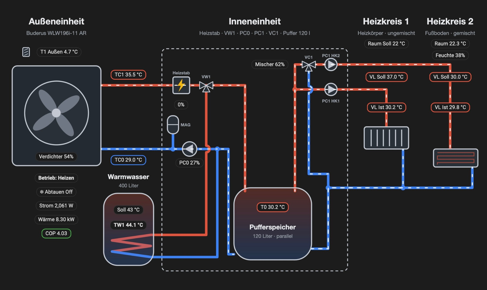

# Home-Assistant-Dashboard für die Buderus WLW196i

Ein YAML-Dashboard für Home Assistant für eine **Buderus Logatherm WLW196i-11 AR** mit Inneneinheit **TP120**. Die Inneneinheit hat einen integrierten 120-Liter-Pufferspeicher und versorgt zwei Heizkreise. Dazu kommt ein externer 400-Liter-Warmwasserspeicher.

Die Daten kommen über [EMS-ESP](https://emsesp.org) per MQTT in Home Assistant.



## Ansichten

| Ansicht | Inhalt |
|---|---|
| **Übersicht** | Betriebszustand, Verdichter, Leistung, COP, Temperaturen, Thermostate HK1/HK2, Tageswerte, 24-h-Verläufe |
| **Anlage** | Animiertes Anlagenschema, siehe unten |
| **Warmwasser** | Speichertemperaturen, Einmalladung, WW-Modus und Komfortstufe, Solltemperaturen, Verläufe |
| **Energie** | JAZ, Tages-COP, Strom und Wärme pro Tag und Monat (Statistik-Diagramme) |
| **Technik** | Kältekreis-Temperaturen und -Drücke, Verdichter, Hydraulik, Mischer HK2, Zusatzheizer, Fehlercodes |
| **PV & Preis** | PV-Überschuss-Steuerung und Tibber-Strompreis |
| **Einstellungen** | Parameter von HK1, HK2 und Wärmepumpe (Silent-Modus, Zusatzheizer usw.) |

## Anlagenschema

Die Ansicht **Anlage** ist eine `picture-elements`-Karte. Sie zeigt die Hydraulik so, wie Buderus sie für die TP120 darstellt:

- **Außeneinheit:** Ventilator, Verdichterdrehzahl, Betriebszustand, Abtau-Anzeige, Strom, Wärme, COP. Die Außentemperatur kommt vom Fühler T1.
- **Inneneinheit:**
  - Heizstab im Vorlauf vor dem Umschaltventil VW1.
  - Pumpe PC0 und Ausdehnungsgefäß im Rücklauf.
  - Pumpe PC1 für HK1, Mischer VC1 und Pumpe PC1 für HK2.
  - Darunter der parallel eingebundene Pufferspeicher mit Fühler T0.
- **Warmwasserspeicher:** 400 Liter mit Wendel, Solltemperatur und TW1.
- **Heizkreis 1 (Heizkörper, ungemischt):** Raum-Soll, Vorlauf Soll und Vorlauf Ist.
- **Heizkreis 2 (Fußboden, gemischt):** Raumtemperatur, Luftfeuchte, Mischerstellung, Vorlauf Soll und Vorlauf Ist.

Animierte Leitungen zeigen, wo gerade Wasser fließt:

| Animation | wird gezeigt, wenn |
|---|---|
| Wärmepumpenkreis und Ventilator | der Verdichter läuft |
| Puffer- bzw. Warmwasser-Zweig | je nach Betriebszustand |
| Heizkreise | die jeweilige Pumpe läuft |
| eisblaue Schneeflocke über dem Ventilator, blau hervorgehobenes Feld „Abtauen“ | die Wärmepumpe abtaut |

Das Schema passt sich dem hellen und dem dunklen Design an. Die Wertefelder wachsen mit der Bildbreite. Zwischen 1100 und 1920 px Fensterbreite überlappen sie nicht. Auf Smartphones ist die Ansicht zu klein.

## Dateien

```
dashboards/waermepumpe.yaml    Dashboard (YAML-Modus), alle sieben Ansichten
packages/waermepumpe.yaml      Template-Sensoren: Betriebszustand (deutsch), COP aktuell/heute,
                               JAZ, Spreizung, Stromkosten heute, Verdichter läuft, Abtauen
www/waermepumpe/schema.svg     Hintergrund des Anlagenschemas (viewBox 1800 × 1060)
www/waermepumpe/flow-*.svg     animierte Fluss-Overlays (Primärkreis, Puffer, Warmwasser, HK1, HK2)
www/waermepumpe/fan.svg        drehender Ventilator
www/waermepumpe/defrost.svg    Abtau-Overlay
examples/utility_meter.yaml    Tageszähler für Strom und Wärme (optional, siehe unten)
docs/anlage.jpg                Screenshot
```

## Voraussetzungen

- **Home Assistant:** getestet mit 2026.11. Benötigt werden Sections-Ansichten und Tile-Features.
- **EMS-ESP:** MQTT-Discovery muss aktiv sein. Die Entitäten heißen `sensor.boiler_*`, `number.boiler_*`, `sensor.thermostat_hc1_*`, `sensor.thermostat_hc2_*`, `sensor.mixer_hc2_*` usw. Bei anderen Präfixen musst du die Namen anpassen.
- **Tageszähler** (Verbrauchszähler, täglich):
  - `sensor.wpconstotal24_2` aus `boiler_nrgconstotal`
  - `sensor.wpconsww24` aus `boiler_nrgconscompww`
  - `sensor.wpsupptotal24` aus `boiler_nrgsupptotal`
  - `sensor.wpsuppheating24` aus `boiler_nrgsuppheating`
  - `sensor.wpsuppww24` aus `boiler_nrgsuppww`

  Als YAML-Alternative gibt es [`examples/utility_meter.yaml`](examples/utility_meter.yaml).
- **Optional für die Ansicht „PV & Preis“:**
  - [emsesp-wp-pv-ueberschuss](https://github.com/mtbsteve/emsesp-wp-pv-ueberschuss) mit der Karte `custom:emsesp-pv-surplus-card`.
  - Die Tibber-Integration (`sensor.haus_*`; der Name hängt vom Namen deines Zuhauses in Tibber ab).

  Ohne diese beiden Integrationen zeigt die Ansicht Fehler- oder „nicht verfügbar“-Karten. Du kannst sie dann einfach löschen.

## Installation

1. Kopiere die Dateien in das Home-Assistant-Konfigurationsverzeichnis:

   ```
   <config>/dashboards/waermepumpe.yaml
   <config>/packages/waermepumpe.yaml
   <config>/www/waermepumpe/*.svg
   ```

   Wenn du über die Samba-Freigabe vom Mac aus kopierst, verwende `cp -X`. Sonst kann Finder mit Fehler 8062 abbrechen, weil die Freigabe `.DS_Store`-Dateien ablehnt.

2. Ergänze `configuration.yaml`:

   ```yaml
   homeassistant:
     packages: !include_dir_named packages

   lovelace:
     dashboards:
       dashboard-wp:
         mode: yaml
         title: Wärmepumpe
         icon: mdi:heat-pump
         show_in_sidebar: true
         filename: dashboards/waermepumpe.yaml
   ```

3. Starte Home Assistant neu. Das ist nur beim ersten Mal nötig, damit Packages und das neue Dashboard geladen werden. Spätere Änderungen am Dashboard werden mit einem Neuladen im Browser sichtbar. Änderungen an den Templates übernimmst du unter **Entwicklerwerkzeuge → YAML → Template-Entitäten neu laden**.

## Anpassen

- **Position der Wertefelder:** Sie sind in Prozent der Bildgröße angegeben. Für einen Punkt (x, y) im SVG mit viewBox 1800 × 1060 gilt `left = x / 18` und `top = y / 10.6`.
- **Geänderte SVG-Dateien:** Erhöhe die Version in den Bild-URLs (`schema.svg?v=4` → `?v=5`), damit der Browser-Cache die neue Datei lädt.
- **Andere Anlage:** Bei einem anderen Aufbau, etwa ohne Mischerkreis oder mit Reihenpuffer, passt du `schema.svg` und die Pfade in den `flow-*.svg` an. Die Overlays verwenden dieselben Koordinaten wie das Schema.
- **Bewusst weggelassen:** Die Ansicht „Einstellungen“ enthält keine Reset-, Shutdown-, Schornsteinfeger- und manuelle Abtau-Schalter.

## Lizenz

[MIT](LICENSE)
